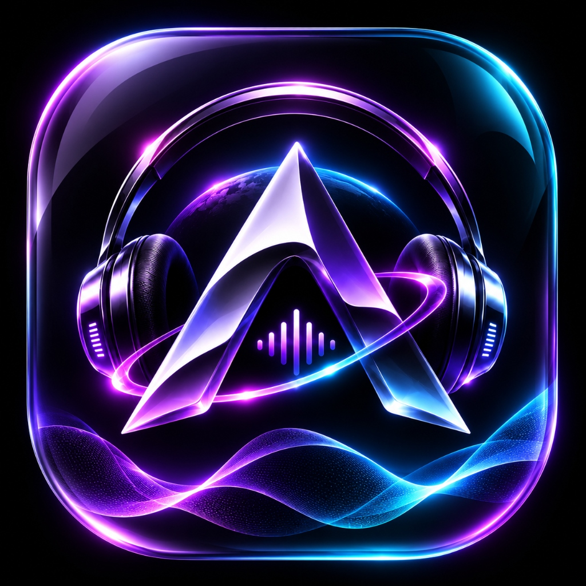
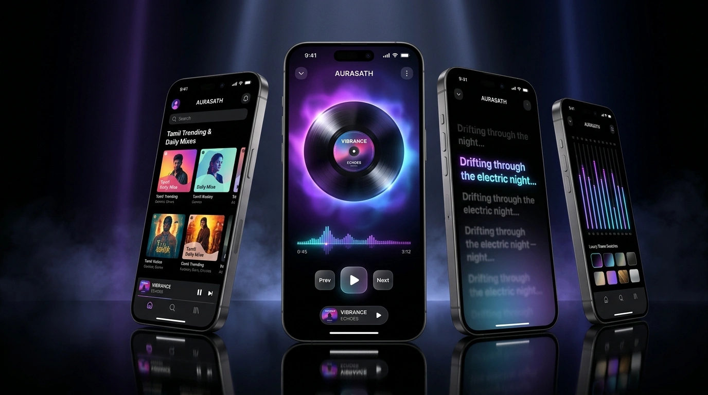
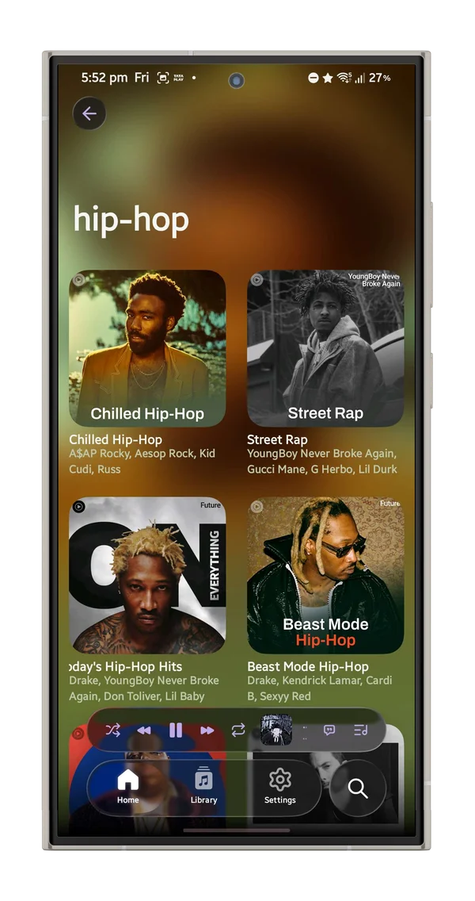
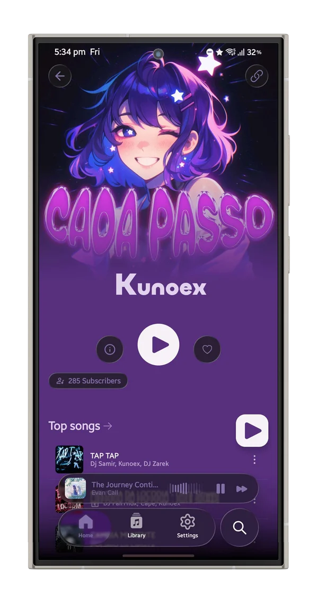
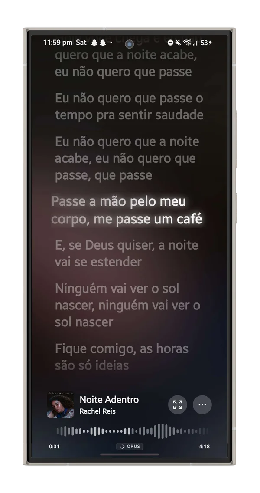
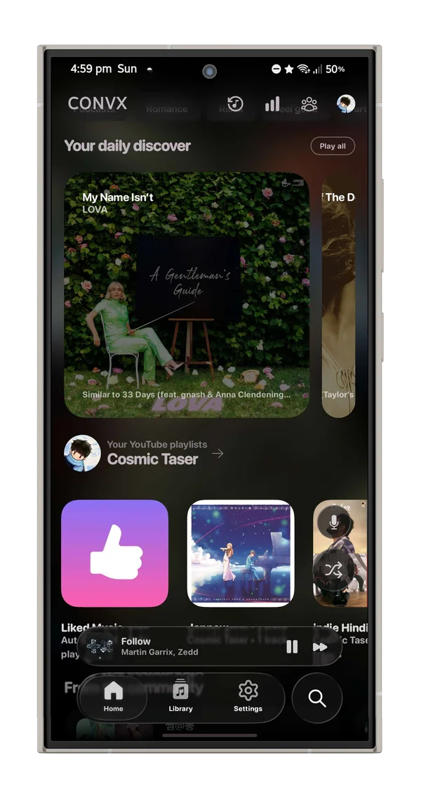

<div align="center">

  <br/>

  <a href="https://github.com/mohammedarsath-ars/AURASATH">
    
  </a>

  <br/><br/>

  <h1>✦ A U R A S A T H ✦</h1>
  <p><b>The Audiophile's Liquid Glass Music Sanctuary for Android</b></p>
  <p><i>Music You Can See • Sound You Can Feel • 100% Commercial-Free Forever</i></p>

  <br/>

  <!-- Badges -->
  <p>
    <a href="https://github.com/mohammedarsath-ars/AURASATH/releases/latest">
      
    </a>
    <a href="https://github.com/mohammedarsath-ars/AURASATH/releases">
      
    </a>
    <a href="LICENSE">
      
    </a>
    <a href="https://www.instagram.com/freaky____arsu">
      
    </a>
    <a href="https://github.com/mohammedarsath-ars/AURASATH">
      
    </a>
  </p>

  <!-- Big Download CTA Button -->
  <p>
    <a href="https://github.com/mohammedarsath-ars/AURASATH/releases/latest">
      
    </a>
    &nbsp;&nbsp;
    <a href="https://github.com/mohammedarsath-ars/AURASATH/releases">
      
    </a>
  </p>

  <sub>⚡ Android 8.0+ • 64-bit ARM & Universal • Zero Commercial Ads • No Account Required</sub>

  <br/><br/>

  <!-- Panoramic Showcase Banner -->
  <a href="https://github.com/mohammedarsath-ars/AURASATH/releases/latest">
    
  </a>

</div>

<br/>

---

## 📱 Flagship App Showcase

<table align="center" width="100%">
  <tr align="center" valign="top">
    <td width="25%">
      
      <br/><b>🏠 Living Home Feed</b><br/>
      <sub>Tamil Trending & Dynamic Mixes</sub>
    </td>
    <td width="25%">
      
      <br/><b>🎧 Liquid Glass Player</b><br/>
      <sub>Live Waveform & 3D Gyroscope</sub>
    </td>
    <td width="25%">
      
      <br/><b>🎙️ Synced Karaoke</b><br/>
      <sub>Word-by-word Syllable Lyrics</sub>
    </td>
    <td width="25%">
      
      <br/><b>🎨 Luxury Themes</b><br/>
      <sub>Ferrari Red, Gold & Neon Swatches</sub>
    </td>
  </tr>
</table>

---

## ✨ Signature Flagship Features

- 🌊 **Live Waveform Seek Bar & Dynamic Aura** — Ultra-smooth, track-seeded waveform scrubber gliding with the audio clock and micro-tactile haptics, synchronized with real-time audio FFT bass energy pulsing through the liquid glass backdrop.
- 🌌 **3D Gyroscope Kinetic Parallax Canvas** — Tilt your phone and watch album artwork physically rotate in 3D space with reactive specular sheen, light reflection glares, and battery-smart sensor sleep.
- 🧊 **Liquid Glass 2.0 Ultra-Optics** — Apple-grade real-time GPU backdrop blur sampling, continuous-curve squircles, and AGSL runtime lens refraction.
- 🎵 **Endless Music Sanctuary (Streaming + Local)** — Stream millions of tracks via YouTube Music with resilient multi-source fallback resolvers (JioSaavn / Tidal) or enjoy your local high-res offline FLAC/MP3 library.
- 🔄 **Spotify Dual Wrapped Sync & 1-Click Importer** — Paste any playlist from Spotify, Apple Music, or Amazon Music to import in seconds. Your playback seamlessly syncs toward both your Spotify Wrapped and YouTube Recap.
- 🎚️ **Pro DJ Automix & Smart Crossfade** — Dynamic tempo alignment, harmonic mixing, and club-style *Echo Freeze* transitions that keep the beat going without jarring silence.
- 🎙️ **Studio-Grade Synced Karaoke Lyrics** — Syllable-by-syllable lyric scrolling powered by LRCLIB, KuGou, and Metrolist timing logic, complete with offline caching, romanization, and instant translation.
- 🎛️ **10-Band Audiophile Equalizer** — Studio precision EQ, Bass Boost, Reverb, Spatial Virtualizer, and hardware pitch/tempo manipulation.
- 🚗 **Android Auto & Google Cast Ready** — Complete in-car dashboard infotainment playback and seamless casting to home speakers and smart TVs.
- 🛡️ **Zero Commercial Ads Forever** — No banner ads, no video popups, no audio interruptions, no tracking SDKs.

---

## 📱 System Requirements & Compatibility

| Feature | Minimum OS Version | Recommended | Behavior on Earlier Versions |
| :--- | :---: | :---: | :--- |
| **Core Audio & Playback** | **Android 8.0** (API 26) | Android 12+ | Full streaming, local playback, lyrics & equalizer supported |
| **Hardware Liquid Glass Blur** | **Android 12** (API 31) | Android 13+ | Uses hardware `RenderEffect`; gracefully falls back to frosted translucent scrim on Android 8.0–11 |
| **AGSL RuntimeShader Lens** | **Android 13** (API 33) | Android 14+ | Real-time optical lens refraction; optimized fallback on low-RAM devices |
| **Themed Dynamic Icons** | **Android 13** (API 33) | Android 13+ | Material You dynamic monochromatic launcher icons |
| **Android Auto & Cast** | **Android 8.0** (API 26) | Any | Compatible across all Android Auto head units and Google Cast devices |

---

## 🚀 Download & Installation

1. Head over to **[Latest Releases (v1.0.0)](https://github.com/mohammedarsath-ars/AURASATH/releases/latest)** and download the build for your device:
   - ⚡ **`AURASATH-v1.0.0-arm64.apk`** — **Recommended for 99% of modern smartphones** (Snapdragon, MediaTek, Tensor, Exynos). Maximally optimized for speed, thermals, and battery efficiency.
   - 🌐 **`AURASATH-v1.0.0-Universal.apk`** — Universal build compatible across all Android architectures, older devices, tablets, and emulators.
2. Open the downloaded `.apk` file and tap **Install** (allow unknown sources if prompted).
3. Experience pure, uninterrupted music wrapped in Liquid Glass 2.0!

---

## 🛠️ Build from Source

AURASATH is built with standard Android tooling and requires **JDK 21** and Android SDK 36/37.

```bash
# 1. Clone the repository
git clone https://github.com/mohammedarsath-ars/AURASATH.git
cd AURASATH

# 2. Setup environment configuration
cp .env.example .env

# 3. Build Universal FOSS Debug APK (no keys required)
./gradlew assembleUniversalFossDebug

# 4. Build Official Universal & ARM64 Release APKs
./gradlew assembleUniversalGmsRelease assembleArm64GmsRelease
```

> [!TIP]
> **Build Flavors**:
> - **ABI**: `arm64` (modern devices), `universal` (all architectures), `x86_64` (emulators).
> - **Variant**: `foss` (100% open-source without Google Play Services) or `gms` (with Google Cast support).

---

## 🔒 Privacy & Network Transparency

AURASATH contains **zero commercial tracking SDKs, zero advertising networks, and zero telemetry frameworks** (no Google Analytics, Firebase Analytics, Crashlytics, or Adjust). 

Every network connection is strictly functional and initiated by you:

| Service | Endpoint | Data Transmitted | Purpose |
| :--- | :--- | :--- | :--- |
| **YouTube Music** | `music.youtube.com` | Search queries, track IDs | Streaming audio streams, album art, search metadata |
| **Stream Resolvers** | JioSaavn / Tidal API | Song titles, artist metadata | Fallback audio stream resolution for unplayable tracks |
| **Lyrics Providers** | LRCLIB, KuGou, Musixmatch | Song title & artist name | Real-time syllable & synced line lyrics |
| **In-App Updater** | `api.github.com` | Anonymous version check | Checking latest GitHub release tags & changelog |
| **Supabase** | `*.supabase.co` | User feedback / bug text | Anonymous update queries; bug reports only when submitted by you |
| **Spotify Sync** | `api.spotify.com` | OAuth token (stored locally) | *(Optional)* Importing your playlists & Dual Wrapped sync |
| **Last.fm** | `audioscrobbler.com` | Song title, artist, timestamp | *(Optional)* Scrobbling music to your Last.fm account |
| **Discord RPC** | `gateway.discord.gg` | Song title, artist, elapsed time | *(Optional)* Displaying rich presence listening status |
| **Listen Together** | WebSocket Gateway | Room code & playback position | *(Optional)* Real-time peer-to-peer group music sync |

---

## 💎 Exclusive Flagship Innovations

AURASATH is engineered with bespoke, flagship-tier capabilities designed for true audiophiles:

- 🧊 **Liquid Glass 2.0 Engine**: Custom AGSL runtime shaders, continuous squircle curvature, and adaptive resolution scaling based on hardware tier.
- 🌌 **3D Gyroscope Kinetic Canvas**: Physics-driven album artwork rotation responding to real device orientation with specular glare.
- 🎚️ **Pro DJ Automix with Echo Freeze**: Real-time tempo alignment and frequency-aware smart crossfades.
- 🔄 **Spotify Dual Wrapped Tracking**: Full playback sync counting toward both Spotify Wrapped and YouTube Music Recap simultaneously.
- 🎯 **Tamil Music Priority Engine**: Specialized home feed discovery & regional shelf filters designed for South Asian audiophiles.
- 📱 **Zero-Clip 72dp Adaptive Launcher Icons**: Calibrated across all 5 screen densities (`mdpi` to `xxxhdpi`) with 0 clipped pixels on circular launchers.

---

<details>
<summary><b>📜 Open-Source Libraries & Acknowledgements (Click to Expand)</b></summary>
<br/>

AURASATH is proudly open-source and respects foundational open-source engineering:

- **[ViMusic](https://github.com/vfsfitvnm/ViMusic)** — Foundational headless media service and player layout architecture.
- **[Kyant0/backdrop & AndroidLiquidGlass](https://github.com/Kyant0/backdrop)** — GPU backdrop sampling and runtime AGSL shader optics.
- **[Metrolist](https://github.com/Metrolist)** — Direct player connection lyrics timing logic.
- **[SimpMusic](https://github.com/dansp/SimpMusic)** — Audio DSP enhancements.
- **[InnerTube](https://github.com/vfsfitvnm/ViMusic)** — Reverse-engineered YouTube Music streaming client.
- **[LRCLIB](https://lrclib.net/)** — Synced lyrics community.
- **[Kizzy / KizzyRPC](https://github.com/my-kizzy)** — Discord Rich Presence client.
- **[SongRec](https://github.com/marin-m/SongRec)** — Shazam-style acoustic recognition.
- **[mpvEx](https://github.com/marlboro-advance/mpvEx)** — Seekbar slider components.

</details>

---

## ⚖️ Unofficial Affiliation Disclaimer

*AURASATH is an independent, non-commercial open-source music player. It is NOT affiliated with, authorized, maintained, sponsored, or endorsed by Google LLC, YouTube, Spotify AB, Apple Inc., Amazon.com Inc., or any of their affiliates or subsidiaries. All product and company names, trademarks, and registered trademarks are the property of their respective holders.*

---

## 👤 Creator

<div align="center">
  <a href="https://github.com/mohammedarsath-ars">
    
  </a>
  <br/>
  <b>Arsath Arsu</b>
  <br/>
  <sub>Creator & Lead Architect</sub>
  <br/><br/>
  <a href="https://www.instagram.com/freaky____arsu">
    
  </a>
  &nbsp;&nbsp;
  <a href="https://github.com/mohammedarsath-ars">
    
  </a>
</div>

<br/>

---

<div align="center">
  <p>⭐ <b>Star this repository if you enjoy AURASATH!</b></p>
  <sub>Licensed under GNU General Public License v3.0 (GPL-3.0)</sub>
</div>
