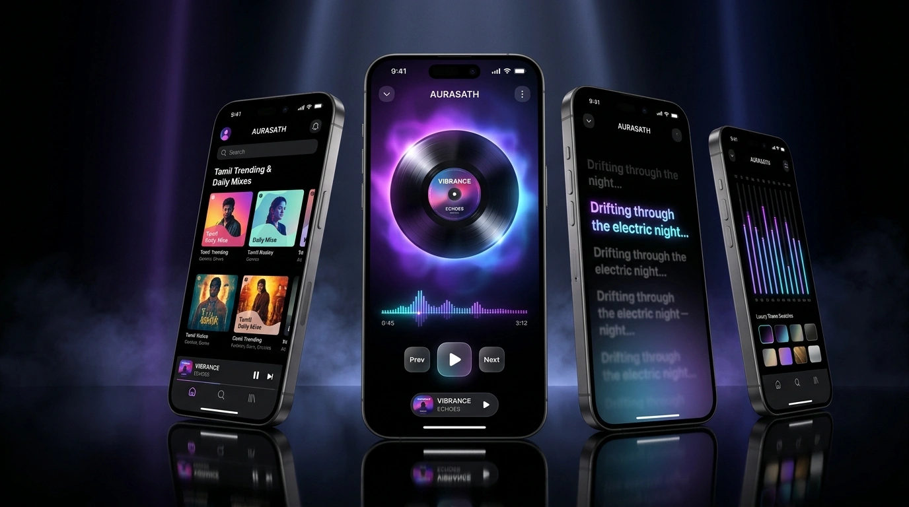

  

    

  # ✦ AURASATH v1.0.0 Flagship Release ✦

  **The Audiophile's Liquid Glass Music Sanctuary for Android**

  *Music You Can See • Sound You Can Feel • 100% Commercial-Free Forever*

   

  <!-- Direct 1-Tap Download Action Buttons -->
  

    
    &nbsp;&nbsp;
    
  

  ⚡ Android 8.0+ • 64-bit ARM & Universal • Zero Commercial Ads • No Account Required

    

---

### ✨ What's New in Flagship v1.0.0

- 🌊 **Synchronized Live Waveform Seek Bar**:
  - Live scrolling waveform visualizer synchronized in real-time with track playback dynamics.
  - **4 Selectable Seekbar Styles**: *Waveform*, *Wavy* (fluid sine wave), *Slim* (touch-expanding track height), and *Default* (Material 3 precision thumb).
  - Micro-tactile haptic ticks during dragging and scrubbing.

- 🌌 **Gyroscope 3D Parallax Canvas**:
  - Album artwork physically rotates in real-time 3D space when you tilt your smartphone.
  - Reactive specular sheen and light reflection glare bouncing across vinyl and cover art.
  - Battery-smart listener automatically unregisters sensors when player is collapsed or screen is off.

- 🧊 **Liquid Glass 2.0 Optics**:
  - Apple-grade real-time GPU backdrop blur sampling, continuous-curve squircles, and AGSL runtime lens refraction with fluid physical feedback.

- 🎨 **Luxury Player Presets & Custom Button Tints**:
  - Full-Screen Apple Music v2 Player with dynamic living aura backdrop blur.
  - Dynamic button tints: Pure Porcelain White, Adaptive Primary Accent, Adaptive Harmony.
  - Curated luxury theme presets: *AURASATH Neon*, *Imperial Gold*, *Ferrari Red*, *Cosmic Nebula*, *Glacier Ice*, plus hex swatch color picker.

- 📱 **Zero-Clip Adaptive Launcher Icons**:
  - Fully calibrated to Google's 72dp safe zone across all 5 screen densities (`mdpi`, `hdpi`, `xhdpi`, `xxhdpi`, `xxxhdpi`) — 0 clipped pixels on circular launchers.
  - High-res antialiased round icon and Material You dynamic themed icon for Android 13+.
  - Redesigned cinematic startup preloader with 3 glowing orbital resonance rings and 9-bar dynamic equalizer.

- 📥 **Universal Playlist & Album Importer**:
  - 1-Click public import from **Spotify**, **Apple Music**, and **Amazon Music** share links.
  - High-precision track resolver matches metadata against YouTube Music without duplicates.

- 🔄 **Spotify Sync & Dual Wrapped**:
  - Connect your Spotify account directly in Settings.
  - Tracks played inside AURASATH register toward both your Spotify Wrapped and YouTube Music Recap.
  - Tamil music trending priority, regional curation, and clutter filter.

- 🛡️ **Top Crash & Performance Fixes**:
  - Fixed null recommendation click crash on dynamic home feed.
  - Null-safe ConnectivityManager system service retrieval.
  - Fixed crossfade secondary player NPE and Compose slot table fallback.

---

### 📲 Which Package Should I Download?

| Package | Recommended For | Architecture | Size |
| :--- | :--- | :--- | :--- |
| **`AURASATH-v1.0.0-Universal.apk`** | **Most Users (Recommended)** — Works on all phones, tablets, and emulators. | All ARM & x86 architectures | ~54 MB |
| **`AURASATH-v1.0.0-arm64.apk`** | Modern 64-bit Android smartphones for optimal size and execution. | `arm64-v8a` only | ~51 MB |

> [!TIP]
> **First-Time Installation**: Since AURASATH is 100% open-source and independent, Android might prompt *"File might be harmful"* or ask to *"Allow from this source"*. Tap **Settings → Allow**, or on Samsung/Xiaomi devices tap **Install Anyway**.

---

  AURASATH Music • Designed with Jetpack Compose & Liquid Glass • Licensed under GPL v3.0

